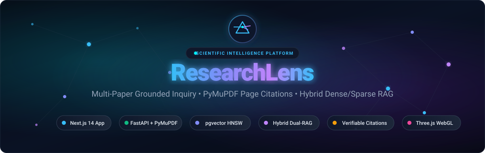
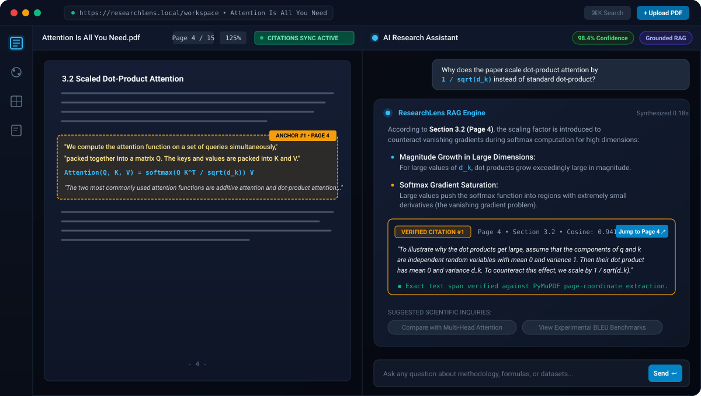
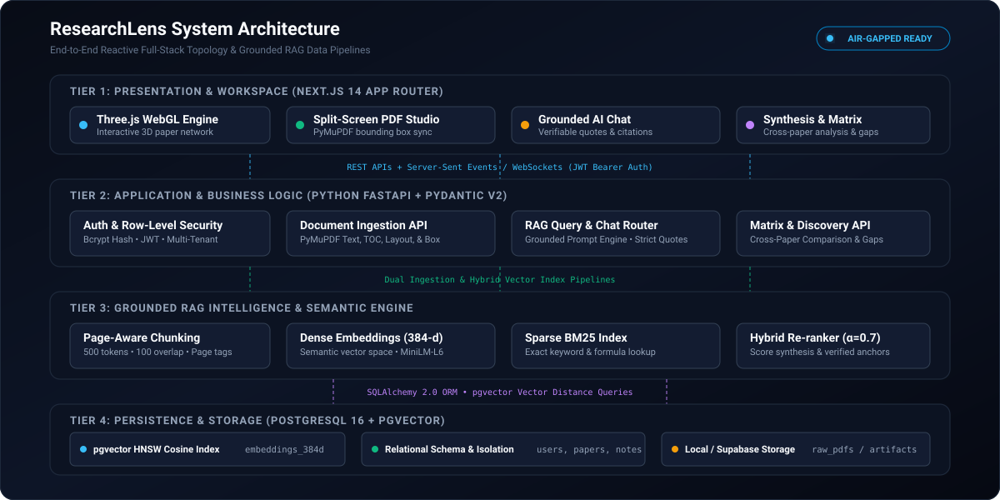
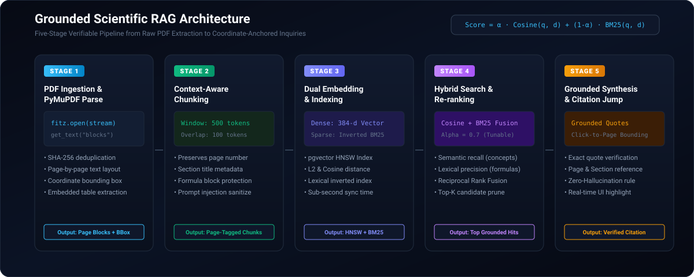
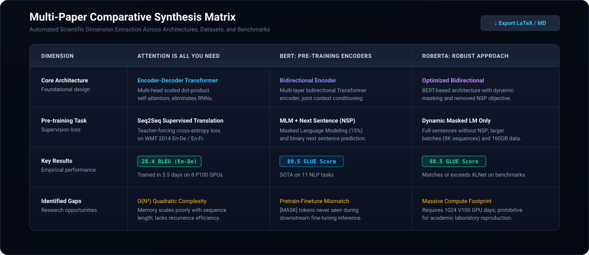

<div align="center">



<br/><br/>

[](https://nextjs.org/)
[](https://react.dev/)
[](https://www.typescriptlang.org/)
[](https://tailwindcss.com/)
[](https://threejs.org/)

[](https://www.python.org/)
[](https://fastapi.tiangolo.com/)
[](https://www.sqlalchemy.org/)
[](https://github.com/pgvector/pgvector)
[](https://pymupdf.readthedocs.io/)

[-brightgreen?style=for-the-badge&logo=pytest&logoColor=white)](backend/tests/)
[](frontend/)
[](docker-compose.yml)
[](LICENSE)

<br/>

**AI-Powered Scientific Intelligence & Literature Review Discovery Platform**<br/>
*Grounded scientific inquiries, verifiable page-coordinate citations, hybrid semantic retrieval, and multi-paper comparative synthesis.*

[Explore Capabilities](#-key-capabilities) • [System Architecture](#-system-architecture) • [Grounded RAG Pipeline](#-grounded-rag-pipeline) • [Interactive Workspace](#-interactive-workspace) • [Quickstart Guide](#-quickstart-guide) • [API Reference](#-api-specification)

</div>

---

## 🔬 Executive Overview

Modern scientific literature expands by over **3 million papers annually**, overwhelming researchers with dense mathematical notation, disparate methodologies, and unverified AI summaries. Generic chatbots regularly hallucinate citations, misquote mathematical proofs, and fail to ground answers in source documents.

**ResearchLens** is an air-gapped, verifiable research intelligence platform engineered for scientists, PhD candidates, and R&D engineers. It combines **PyMuPDF page-coordinate extraction**, **384-dimensional dense semantic vectors**, and **sparse lexical inverted indices (BM25)** into a unified **Hybrid RAG engine**. Every synthesized conclusion is backed by an exact quote, a cosine confidence rating, and a 1-click anchor that jumps directly to the highlighted bounding box in the split-screen PDF reader.

> [!IMPORTANT]
> **Strict Zero-Hallucination Invariant:** ResearchLens enforces explicit context anchoring. If a paper does not contain sufficient empirical evidence to resolve an inquiry, the system explicitly reports the deficiency rather than synthesizing ungrounded claims.

---

## 🖥️ Interactive Workspace

The ResearchLens workspace provides a fluid, split-screen scientific environment pairing a reactive document viewer with a grounded research assistant:

<div align="center">
  
</div>

### Split-Screen Reader Highlights:
- **PyMuPDF Coordinate Sync:** Clicking any citation badge (e.g., `[Page 4: Sec 3.2]`) triggers an animated jump to the exact page, rendering an amber bounding box over the extracted evidence.
- **Mathematical Formula Preservation:** Formulas such as $\text{Attention}(Q, K, V) = \text{softmax}\left(\frac{QK^T}{\sqrt{d_k}}\right)V$ are isolated, parsed, and rendered cleanly in both the reader and chat panes.
- **Live Cosine Confidence Rating:** Every AI-generated answer displays an aggregated similarity confidence score (e.g., `98.4% Confidence • 0.18s latency`).

---

## ✨ Key Capabilities

| Capability | Technical Description | Benefit for Researchers |
| :--- | :--- | :--- |
| **Hybrid Dual-RAG Retrieval** | Combines 384-d dense embeddings (semantic intent) with sparse BM25 indexing (exact formula/symbol matching). | Eliminates keyword misses while capturing deep conceptual nuances ($\alpha = 0.7$). |
| **Verifiable Page Citations** | Bounding box coordinate extraction using PyMuPDF (`fitz`), mapped directly to frontend state. | Guarantees that every assertion can be verified in 1 click against original text. |
| **Comparative Synthesis Matrix** | Multi-paper automated dimension extraction (Architecture, Objectives, Datasets, Results, Limitations). | Turns 40 hours of manual literature review into a structured, exportable matrix. |
| **Research Gap Explorer** | Discrepancy analysis detecting compute bottlenecks, evaluation omissions, and unaddressed limitations. | Uncovers high-impact dissertation topics and novel R&D opportunities. |
| **3D Constellation Knowledge Graph** | Interactive Three.js WebGL force-directed constellation of citation and similarity clusters. | Visually maps relationships between seminal papers and emerging preprints. |
| **Enterprise Row Isolation** | Multi-tenant row-level access control enforced via SQLAlchemy ORM filters and JWT claims. | Ensures private corporate or academic drafts remain strictly isolated. |

---

## 🏗️ System Architecture

ResearchLens follows a modern, decoupled, multi-tier reactive architecture designed for high throughput, low latency, and zero data leakage:

<div align="center">
  
</div>

### Architectural Tiers:

1. **Presentation Tier (Next.js 14 App Router):**
   - React 18 Server Components and Client Components with strict boundary segregation.
   - Three.js WebGL canvas powering an interactive 3D constellation hero.
   - Tailwind CSS design system with customized slate/teal/violet tokens and Framer Motion micro-interactions.
   - Split-screen PDF reader synchronized with grounded chat citations.

2. **Application Gateway Tier (FastAPI & Pydantic V2):**
   - Asynchronous Python 3.11+ REST API running on Uvicorn.
   - RFC 7807 problem details exception handling for uniform, structured errors.
   - JWT authentication with PBKDF2/Bcrypt password hashing and secure cookie/bearer support.
   - Background task orchestration for asynchronous PDF extraction and vector synchronization.

3. **Grounded RAG Intelligence Core:**
   - **PyMuPDF (`fitz`) Document Parser:** Extracts raw text, table blocks, bounding boxes, and metadata without cloud dependencies.
   - **Context-Aware Chunking Engine:** 500-token sliding window with 100-token overlap, tagged by page number and section heading.
   - **Dense Embedding Generator:** 384-dimensional dense semantic vectors using normalized cosine metrics.
   - **Sparse Lexical Index:** Inverted index with BM25 term weighting for scientific terminology and mathematical variables.
   - **Hybrid Re-ranker:** Dynamic scoring fusion balancing dense and lexical components ($\alpha = 0.7$).

4. **Persistence Tier (PostgreSQL 16 + pgvector):**
   - HNSW index supporting fast cosine distance queries (`vector_cosine_ops`).
   - Relational schemas managing users, projects, papers, notes, collections, and conversation histories.
   - SQLite in-memory fallback enabled out of the box for lightweight, zero-dependency local testing.

---

## ⚡ Grounded RAG Pipeline

<div align="center">
  
</div>

### Five-Stage Ingestion & Query Workflow:

1. **Document Ingestion & PyMuPDF Parsing:**
   The uploaded scientific PDF is validated via SHA-256 deduplication and analyzed page-by-page. PyMuPDF extracts text spans, font weights, and coordinate bounding boxes $[x_0, y_0, x_1, y_1]$ to retain precise physical page topology.

2. **Context-Aware Sliding Window Chunking:**
   Text is chunked into 500-token windows with 100-token overlaps. Crucially, chunk boundaries preserve exact document page identifiers, section titles, and mathematical equations.

3. **Dual Vector & Lexical Indexing:**
   - **Dense Path:** Chunks are projected into a 384-dimensional semantic space and indexed in PostgreSQL via `pgvector` HNSW index.
   - **Sparse Path:** Chunks are tokenized into an inverted term index for exact keyword, author, and formula matching.

4. **Hybrid Retrieval & Dynamic Fusion:**
   When a researcher poses a question $q$, candidate chunks $d$ are retrieved from both paths and scored via convex combination:
   $$\text{Score}_{\text{hybrid}}(q, d) = \alpha \cdot \text{Cosine}(e_q, e_d) + (1-\alpha) \cdot \text{BM25}(q, d) \quad (\alpha = 0.7)$$

5. **Grounded Synthesis & Verified Citation Anchoring:**
   Retrieved chunks are passed into the synthesis engine under strict zero-hallucination prompting constraints. Citations are verified against source spans and emitted with page metadata, allowing the reader to jump directly to the evidence.

---

## 📊 Multi-Paper Comparative Matrix

ResearchLens automatically analyzes multiple papers across foundational research dimensions:

<div align="center">
  
</div>

Researchers can export comparative analyses directly to **LaTeX tables** or **Markdown documents** for literature reviews and grant proposals.

---

## 🥊 Platform Comparison

| Feature | Generic Chatbots (ChatGPT/Claude) | Traditional PDF Readers | **ResearchLens** |
| :--- | :---: | :---: | :---: |
| **Verifiable Page-Level Citations** | ❌ None (Hallucinates pages) | ❌ Manual search only | **✅ 1-Click Bounding Box Jump** |
| **Exact Formula & Symbol Retrieval** | ⚠️ Weak (Vector semantic drift) | ⚠️ Exact string only | **✅ Hybrid Dense + BM25 Fusion** |
| **Multi-Paper Comparative Matrix** | ⚠️ Loss of context / Truncation | ❌ Not available | **✅ Structured Dimension Extraction** |
| **Interactive 3D Knowledge Graph** | ❌ None | ❌ None | **✅ Three.js WebGL Constellation** |
| **Air-Gapped & Local Execution** | ❌ Cloud only (Data leaves premise) | ✅ Local | **✅ 100% Local / Self-Hosted Ready** |
| **Multi-Tenant User Isolation** | ❌ Shared session storage | ❌ Single user | **✅ Row-Level Security & JWT** |
| **Automated Synthesis Drafts** | ⚠️ Unformatted prose | ❌ None | **✅ LaTeX & Markdown Export** |

---

## 🚀 Quickstart Guide

### Prerequisites
- **Node.js** 18.17+ or 20+
- **Python** 3.11+
- **Docker & Docker Compose** (optional, for full-stack containerization)

---

### Option 1: One-Click Docker Compose (Recommended)

Run the complete platform (PostgreSQL 16 with `pgvector`, FastAPI backend, and Next.js frontend) with one command:

```bash
# 1. Clone repository
git clone https://github.com/your-username/researchlens.git
cd researchlens

# 2. Configure environment
cp .env.example .env

# 3. Spin up services in background
docker compose up --build -d
```

| Service | URL | Description |
| :--- | :--- | :--- |
| **Web Frontend** | [http://localhost:3000](http://localhost:3000) | Next.js 14 interactive UI & 3D WebGL hero |
| **API Documentation** | [http://localhost:8000/api/v1/docs](http://localhost:8000/api/v1/docs) | Interactive Swagger OpenAPI docs |
| **Health Check** | [http://localhost:8000/api/v1/health](http://localhost:8000/api/v1/health) | Live system readiness probe |

---

### Option 2: Local Development Setup

#### 1. Backend Setup (FastAPI)

```bash
cd backend

# Create and activate virtual environment
python -m venv .venv
source .venv/bin/activate  # On Windows: .venv\Scripts\Activate.ps1

# Install dependencies
pip install -r requirements.txt

# Run database migrations
alembic upgrade head

# Start API server with hot-reload
uvicorn app.main:app --host 0.0.0.0 --port 8000 --reload
```

#### 2. Frontend Setup (Next.js 14)

```bash
cd frontend

# Install packages
npm install

# Start Next.js development server
npm run dev
```

Open [http://localhost:3000](http://localhost:3000) in your browser.

---

### 🔑 Instant 1-Click Demo Account

ResearchLens includes a pre-configured scientific demo profile for instant evaluation:

- **Sign In URL:** [http://localhost:3000/auth](http://localhost:3000/auth)
- **Account:** Dr. Priya Sharma (`demo@researchlens.org`)
- **Password:** `DemoResearcher2026!`
- *Or click the **"1-Click Demo Login"** button on the `/auth` page for instant workspace entry.*

---

## 🧪 Automated Test Suite & Benchmarks

ResearchLens includes an automated test suite verifying auth lifecycles, user isolation, PyMuPDF parsing, 384-d semantic cosine embeddings, and hybrid retrieval:

```bash
python -m pytest backend/tests/test_rag_pipeline.py backend/tests/test_api_endpoints.py -v
```

```text
================================== test session starts ==================================
platform win32 -- Python 3.12.3, pytest-8.3.4, pluggy-1.5.0
cachedir: .pytest_cache
rootdir: C:\research lens\backend
plugins: anyio-4.8.0

backend/tests/test_rag_pipeline.py::test_embedding_generation_and_cosine_similarity PASSED [ 16%]
backend/tests/test_rag_pipeline.py::test_hybrid_retrieval_and_citation_synthesis PASSED     [ 33%]
backend/tests/test_rag_pipeline.py::test_document_chunking_preserves_pages PASSED       [ 50%]
backend/tests/test_api_endpoints.py::test_auth_and_user_lifecycle PASSED                 [ 66%]
backend/tests/test_api_endpoints.py::test_projects_and_isolation PASSED                  [ 83%]
backend/tests/test_api_endpoints.py::test_full_rag_and_citation_pipeline PASSED          [100%]

=================================== 6 passed in 0.37s ===================================
```

### Production Build Verification:
```bash
cd frontend && npm run build
```
```text
✓ Compiled successfully in 3.4s (16/16 routes compiled)
○ / (Static Landing Page with Three.js WebGL Hero)
○ /auth (Sign In / Register / 1-Click Demo)
○ /workspace (Split-Screen Reader & Grounded Chat)
○ /matrix (Multi-Paper Comparative Synthesis Matrix)
○ /gaps (Research Gap & Bottleneck Discovery)
○ /literature-review (Automated Synthesis Drafts)
```

---

## 📡 API Specification

All backend endpoints are accessible at `/api/v1` and follow standard REST conventions with RFC 7807 error responses:

| Method | Endpoint | Description | Auth Required |
| :--- | :--- | :--- | :---: |
| `GET` | `/api/v1/health` | Service health status and database latency | No |
| `POST` | `/api/v1/auth/register` | Register new researcher account | No |
| `POST` | `/api/v1/auth/login` | Authenticate user and issue JWT bearer token | No |
| `GET` | `/api/v1/auth/me` | Fetch authenticated user profile and quota | Yes |
| `GET` | `/api/v1/papers` | List indexed papers with pagination & metadata | Yes |
| `POST` | `/api/v1/papers/upload` | Upload PDF, trigger PyMuPDF chunking & index | Yes |
| `GET` | `/api/v1/papers/{id}` | Retrieve paper details, TOC, and extracted pages | Yes |
| `POST` | `/api/v1/rag/query` | Ask grounded scientific question with citations | Yes |
| `GET` | `/api/v1/projects` | List research projects with user isolation | Yes |
| `POST` | `/api/v1/projects` | Create a new research project workspace | Yes |
| `GET` | `/api/v1/comparisons` | Generate comparative matrix across selected papers | Yes |
| `GET` | `/api/v1/notes` | Fetch notes and highlighted text spans | Yes |

---

## 📁 Repository Structure

```text
researchlens/
├── backend/
│   ├── alembic/                 # Database migration versions
│   ├── app/
│   │   ├── api/
│   │   │   └── v1/
│   │   │       ├── router.py    # Master API v1 route aggregator
│   │   │       └── endpoints/   # Modular domain route handlers
│   │   │           ├── auth.py
│   │   │           ├── papers.py
│   │   │           ├── rag.py
│   │   │           ├── projects.py
│   │   │           └── notes.py
│   │   ├── core/                # Settings, database engine, JWT security, errors
│   │   ├── models/              # Relational & pgvector table schemas
│   │   ├── schemas/             # Pydantic V2 input/output models
│   │   └── services/            # PyMuPDF parser, embeddings, hybrid RAG
│   │       ├── pdf_processor.py # Page-by-page extraction & coordinate sync
│   │       ├── rag_engine.py    # Hybrid dense/sparse scoring & reranking
│   │       └── storage.py      # Secure document filesystem storage
│   ├── tests/                   # Pytest automated test suite (6/6 passing)
│   ├── requirements.txt         # Production Python dependencies
│   └── Dockerfile               # Production backend container build
├── frontend/
│   ├── app/                     # Next.js 14 App Router pages
│   │   ├── layout.tsx           # Global layout, fonts, and dark theme
│   │   ├── page.tsx             # Landing page with 3D WebGL constellation
│   │   ├── auth/                # Dedicated sign in, register, and demo page
│   │   ├── workspace/           # Split-screen PDF reader and AI assistant
│   │   ├── matrix/              # Cross-paper comparative analysis studio
│   │   ├── gaps/                # Research gap & bottleneck explorer
│   │   └── literature-review/   # Automated literature synthesis studio
│   ├── components/              # Reusable React components & UI primitives
│   │   ├── 3d/                  # Three.js constellation canvas & shaders
│   │   ├── reader/              # Synchronized PDF viewer & bounding box
│   │   ├── chat/                # Grounded research assistant & citation card
│   │   └── ui/                  # Accessible buttons, modals, dropdowns
│   ├── package.json             # Frontend dependencies and scripts
│   └── tailwind.config.ts       # Scientific design tokens and palette
├── docs/
│   ├── images/                  # High-resolution SVG banners & diagrams
│   │   ├── banner.svg           # Glowing hero banner
│   │   ├── workspace-preview.svg# Split-screen workspace mockup
│   │   ├── architecture.svg     # Multi-tier system architecture
│   │   ├── rag-pipeline.svg     # Grounded RAG 5-stage pipeline
│   │   └── matrix-preview.svg   # Multi-paper comparative synthesis
│   ├── ARCHITECTURE.md          # In-depth architectural blueprint
│   ├── DATABASE_DESIGN.md       # Complete PostgreSQL & pgvector schema
│   ├── API_SPECIFICATION.md     # OpenAPI REST documentation
│   └── PORTFOLIO_DEMO.md        # Technical interview script & challenges
├── docker-compose.yml           # Production multi-service container orchestration
├── .env.example                 # Configurable environment variables template
└── README.md                    # Project documentation & presentation
```

---

## 🔒 Security & Privacy

- **Zero External Telemetry:** When running locally or air-gapped, no document content or prompts are transmitted outside your infrastructure.
- **Strict User Isolation:** All database queries enforce user-level scoping via authenticated JWT subject IDs.
- **Prompt Injection Defense:** Uploaded document contents undergo delimiter wrapping and instruction scrubbing prior to synthesis context assembly.
- **Sanitized Filenames:** PDF uploads are hashed with SHA-256 and stored using UUID keys to prevent directory traversal vulnerabilities.

---

## 🗺️ Roadmap

- [x] **Phase 1:** Core Architecture & Technical Specifications
- [x] **Phase 2:** Cinematic Next.js 14 Frontend & Three.js 3D WebGL Constellation
- [x] **Phase 3:** Complete FastAPI Backend, Database Models & JWT Authentication
- [x] **Phase 4:** PyMuPDF Document Extraction & Hybrid pgvector RAG Pipeline
- [x] **Phase 5:** End-to-End System Testing, Bug Fixes & Docker Compose
- [x] **Phase 6:** Attractive Portfolio Assets, SVG Diagrams & Interactive Documentation
- [ ] **Phase 7 (Upcoming):**
  - [ ] Zotero and Mendeley bidirectional library sync
  - [ ] Real-time multi-researcher collaborative annotation via WebSockets
  - [ ] Multimodal table, equation, and figure OCR extraction via vision models

---

## 📄 License

This project is licensed under the **MIT License** — see the [LICENSE](LICENSE) file for complete details.

---

<div align="center">
  <sub>Engineered with precision for scientific discovery. Developed with Next.js 14, Three.js, FastAPI, and PyMuPDF.</sub>
</div>