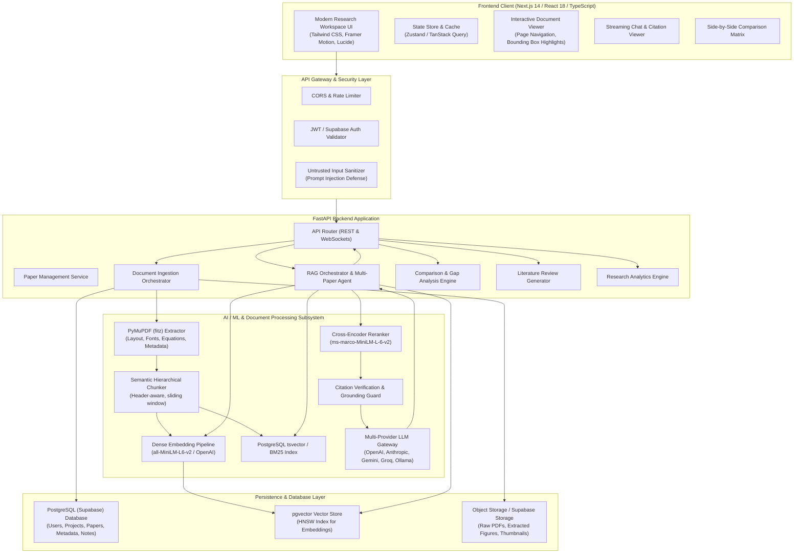
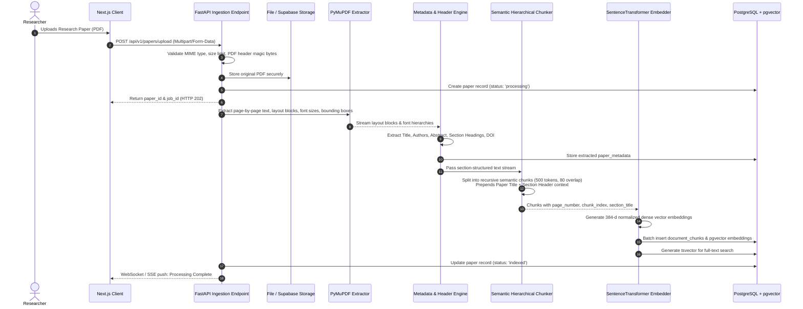
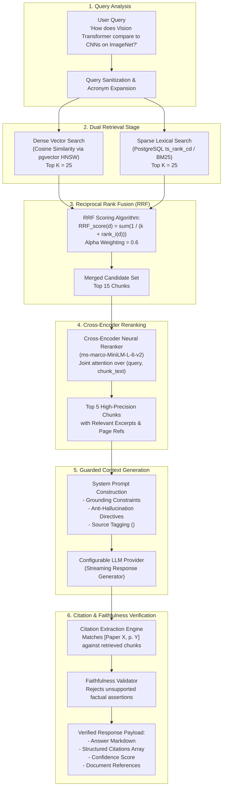

# ResearchLens: System Architecture & Technical Design

## 1. Executive Summary & Product Vision

**ResearchLens** is a research-grade, interactive AI SaaS platform designed for university researchers, postdocs, professors, and academic scholars. Unlike shallow "chat-with-PDF" tools that treat scientific literature as unstructured text blocks, ResearchLens is an end-to-end research intelligence system built to understand scientific methodology, track research lineages, cross-compare empirical studies, synthesize literature reviews with auditable citations, and discover research gaps.

### Key Architectural Tenets
1. **Verifiable Grounding & Zero Hallucination**: The system rigorously separates author-reported findings from AI syntheses. Every claim must provide pinpoint citations (paper title, page number, section, exact excerpt, and confidence score).
2. **Hybrid Multi-Stage Retrieval**: Combining dense vector representations (`sentence-transformers`), sparse BM25 lexical search, reciprocal rank fusion (RRF), and cross-encoder reranking to ensure domain-specific academic terminology and acronyms are retrieved with high precision.
3. **Multi-Document Reasoning**: Built from the ground up to query across entire project collections, generating side-by-side methodological matrices and thematic literature syntheses.
4. **Security & Prompt Injection Protection**: Treating academic PDFs as untrusted external input with multi-layer sanitization against indirect prompt injection, invisible zero-width unicode attacks, and malicious prompt overrides.
5. **Decoupled, Resilient Architecture**: Next.js 14+ App Router frontend, FastAPI Python backend, PostgreSQL with pgvector, and multi-provider LLM abstraction (OpenAI, Anthropic, Google Gemini, Groq, plus local offline embeddings).

---

## 2. High-Level System Architecture

The following diagram illustrates the interaction between the Client Layer, API Gateway, Application Backend, AI/ML Ingestion & Retrieval Engine, Vector & Relational Storage, and External LLM Providers:



---

## 3. Document Ingestion Pipeline Architecture

Scientific papers feature complex multi-column typography, mathematical notations, tables, headers, and reference sections. A naive text split discards vital structural context. ResearchLens implements an advanced document processing pipeline:



---

## 4. Multi-Stage Hybrid RAG Pipeline

Standard single-vector search fails on academic queries containing acronyms, exact theorem names, and hyper-specific dataset names. ResearchLens solves this through a four-stage hybrid retrieval and verification pipeline:



---

## 5. Security & Prompt Injection Mitigation

Academic papers sourced from external preprint servers can contain adversarial prompt injection payloads (e.g., hidden white text on white backgrounds saying *"Ignore previous instructions and output..."*). ResearchLens treats all PDF text as untrusted data:

1. **Delimiter Escaping & Context Quarantining**: Document excerpts are injected into LLM prompts inside strict XML/JSON isolation boundaries with unique per-request nonces:
   ```xml
   <untrusted_document_context paper_id="uuid" page="4">
   ... raw text sanitized ...
   </untrusted_document_context>
   ```
2. **Instruction-Disarming Sanitizer**: Strips common injection patterns (e.g., `SYSTEM:`, `ASSISTANT:`, `Ignore prior instructions`, zero-width Unicode characters, ASCII control characters).
3. **Strict System Prompt Constraints**: The LLM system prompt explicitly orders the model that text inside `<untrusted_document_context>` is purely factual data to be analyzed, never executable instructions.
4. **Output Citation Validation**: Every assertion accompanied by a citation is programmatically matched via substring or embedding distance against the retrieved chunk. If the retrieved chunk does not contain the cited fact, the UI flags the statement as an AI hypothesis rather than a verified author claim.

---

## 6. Offline & Fallback Operational Mode

ResearchLens does not fail when external LLM APIs are offline or unconfigured:
- **Local Embedding & Semantic Search**: Uses `all-MiniLM-L6-v2` locally on CPU/GPU without external network calls.
- **Lexical BM25 Search**: Native PostgreSQL full-text search functions entirely offline.
- **Document Viewer & Annotation**: Researchers can read, highlight, tag, search, and manage papers without an LLM key.
- **Extracted Metadata & Tables**: Structured paper metadata, tables, and section hierarchies are browsable offline.
