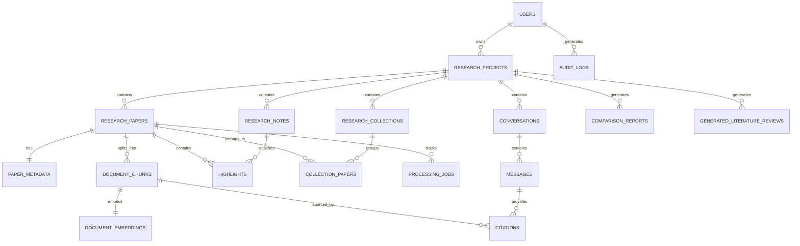

# ResearchLens: Database Architecture & Schema Specification

## 1. Relational Model & Entity-Relationship Architecture

ResearchLens utilizes a normalized PostgreSQL schema designed for strict multi-tenant isolation, auditability, rapid vector retrieval with `pgvector`, and comprehensive academic research workflows.

### Entity-Relationship Diagram



---

## 2. Table Specifications & Data Dictionaries

### 2.1 Core Workspace Entities

#### `users`
Represents researchers, students, and administrators.
- `id` (UUID, PK): Unique user identifier.
- `email` (VARCHAR(255), UNIQUE, NOT NULL): Authentication email address.
- `hashed_password` (VARCHAR(255), NULLABLE): Argon2/Bcrypt hash (nullable if using external Supabase Auth).
- `full_name` (VARCHAR(255), NOT NULL): Academic or display name.
- `institution` (VARCHAR(255)): University, lab, or research organization.
- `role` (VARCHAR(50), DEFAULT 'researcher'): Role for RBAC (`researcher`, `admin`, `guest`).
- `created_at` (TIMESTAMPTZ, DEFAULT NOW()): Record creation timestamp.
- `updated_at` (TIMESTAMPTZ, DEFAULT NOW()): Last modification timestamp.

#### `research_projects`
Top-level workspaces that encapsulate paper libraries, notes, reviews, and chats.
- `id` (UUID, PK): Project identifier.
- `user_id` (UUID, FK -> users.id, ON DELETE CASCADE): Owner of the project.
- `title` (VARCHAR(255), NOT NULL): Research project title (e.g. "Transformer Optimization for Edge Devices").
- `description` (TEXT): Research goals, hypotheses, and scope.
- `research_field` (VARCHAR(100)): Primary discipline (e.g., Computer Science, Bioengineering, Economics).
- `created_at` (TIMESTAMPTZ, DEFAULT NOW()).
- `updated_at` (TIMESTAMPTZ, DEFAULT NOW()).

---

### 2.2 Paper Ingestion & Document Hierarchy

#### `research_papers`
Academic documents uploaded to a research project.
- `id` (UUID, PK): Paper identifier.
- `project_id` (UUID, FK -> research_projects.id, ON DELETE CASCADE).
- `user_id` (UUID, FK -> users.id, ON DELETE CASCADE).
- `file_name` (VARCHAR(500), NOT NULL): Original uploaded filename.
- `file_size_bytes` (BIGINT, NOT NULL): Size of file in bytes.
- `file_hash` (CHAR(64), NOT NULL): SHA-256 checksum to prevent duplicate uploads within project.
- `storage_path` (VARCHAR(1000), NOT NULL): Internal filesystem or Supabase S3 bucket URI.
- `page_count` (INT, DEFAULT 0): Total pages extracted by PyMuPDF.
- `processing_status` (VARCHAR(50), DEFAULT 'pending'): `pending`, `parsing`, `chunking`, `embedding`, `indexed`, `failed`.
- `error_message` (TEXT, NULLABLE): Descriptive error if parsing or chunking failed.
- `created_at` (TIMESTAMPTZ, DEFAULT NOW()).
- `updated_at` (TIMESTAMPTZ, DEFAULT NOW()).

#### `paper_metadata`
Extracted bibliographic and scientific attributes.
- `id` (UUID, PK).
- `paper_id` (UUID, FK -> research_papers.id, ON DELETE CASCADE, UNIQUE).
- `title` (TEXT, NOT NULL): Canonical paper title extracted from PDF header.
- `authors` (TEXT[], DEFAULT '{}'): List of contributing authors.
- `abstract` (TEXT): Paper abstract.
- `publication_year` (INT): Year of publication.
- `journal_or_venue` (VARCHAR(500)): Conference or journal name (e.g., NeurIPS, IEEE, Nature).
- `doi` (VARCHAR(255)): Digital Object Identifier if present.
- `keywords` (TEXT[], DEFAULT '{}'): Extracted or author-provided keywords.
- `primary_methodology` (VARCHAR(255)): Extracted methodological category (e.g., Empirical Benchmark, Theoretical Proof).
- `primary_dataset` (VARCHAR(255)): Primary benchmark or dataset referenced.
- `created_at` (TIMESTAMPTZ, DEFAULT NOW()).
- `updated_at` (TIMESTAMPTZ, DEFAULT NOW()).

#### `document_chunks`
Hierarchical semantic chunks partitioned for retrieval.
- `id` (UUID, PK).
- `paper_id` (UUID, FK -> research_papers.id, ON DELETE CASCADE).
- `chunk_index` (INT, NOT NULL): Zero-based sequential chunk index within the document.
- `page_number` (INT, NOT NULL): 1-indexed document page number where chunk begins.
- `section_title` (VARCHAR(255)): Header or section title (e.g. "3. Methodology and Model Architecture").
- `content` (TEXT, NOT NULL): Raw chunk text with leading context header.
- `token_count` (INT, NOT NULL): Approximate token length.
- `tsv` (TSVECTOR): Generated full-text search vector for lexical retrieval.
- `created_at` (TIMESTAMPTZ, DEFAULT NOW()).

#### `document_embeddings`
Vector representations generated from chunks.
- `id` (UUID, PK).
- `chunk_id` (UUID, FK -> document_chunks.id, ON DELETE CASCADE, UNIQUE).
- `paper_id` (UUID, FK -> research_papers.id, ON DELETE CASCADE).
- `embedding_model` (VARCHAR(100), NOT NULL): e.g., `sentence-transformers/all-MiniLM-L6-v2`.
- `embedding` (VECTOR(384), NOT NULL): Normalized 384-dimensional dense vector.
- `created_at` (TIMESTAMPTZ, DEFAULT NOW()).

---

### 2.3 RAG Conversation & Traceable Citations

#### `conversations`
Chat sessions tied to either a single paper or an entire project.
- `id` (UUID, PK).
- `project_id` (UUID, FK -> research_projects.id, ON DELETE CASCADE).
- `user_id` (UUID, FK -> users.id, ON DELETE CASCADE).
- `paper_id` (UUID, FK -> research_papers.id, ON DELETE SET NULL, NULLABLE): Scoped paper (or NULL for multi-paper).
- `title` (VARCHAR(255), NOT NULL DEFAULT 'New Research Discussion').
- `created_at` (TIMESTAMPTZ, DEFAULT NOW()).
- `updated_at` (TIMESTAMPTZ, DEFAULT NOW()).

#### `messages`
Individual dialog turns.
- `id` (UUID, PK).
- `conversation_id` (UUID, FK -> conversations.id, ON DELETE CASCADE).
- `sender_role` (VARCHAR(20), NOT NULL): `user`, `assistant`, `system`.
- `content` (TEXT, NOT NULL): Display markdown text.
- `raw_response` (JSONB, NULLABLE): Diagnostic payload including model used, prompt tokens, completion tokens.
- `created_at` (TIMESTAMPTZ, DEFAULT NOW()).

#### `citations`
Auditable links between assistant statements and specific document chunks.
- `id` (UUID, PK).
- `message_id` (UUID, FK -> messages.id, ON DELETE CASCADE).
- `chunk_id` (UUID, FK -> document_chunks.id, ON DELETE CASCADE).
- `paper_id` (UUID, FK -> research_papers.id, ON DELETE CASCADE).
- `page_number` (INT, NOT NULL): Target page number.
- `exact_quote` (TEXT, NOT NULL): Verbatim string extracted from source paper.
- `confidence_score` (FLOAT, NOT NULL): Semantic similarity or cross-encoder score (0.00 - 1.00).
- `verification_status` (VARCHAR(50), DEFAULT 'verified'): `verified`, `unverified`, `ai_hypothesis`.
- `created_at` (TIMESTAMPTZ, DEFAULT NOW()).

---

### 2.4 Research Synthesis & Discovery

#### `comparison_reports`
Side-by-side multi-paper methodological evaluations.
- `id` (UUID, PK).
- `project_id` (UUID, FK -> research_projects.id, ON DELETE CASCADE).
- `user_id` (UUID, FK -> users.id, ON DELETE CASCADE).
- `title` (VARCHAR(255), NOT NULL): e.g. "Comparative Analysis: BERT vs RoBERTa vs DeBERTa".
- `paper_ids` (UUID[], NOT NULL): Array of analyzed paper UUIDs.
- `matrix_json` (JSONB, NOT NULL): Structured JSON grid with cells:
  - objective, problem, methodology, dataset, algorithms, metrics, results, limitations, future_work.
- `comparative_synthesis_markdown` (TEXT, NOT NULL): AI synthesis summarizing key methodological divergences.
- `created_at` (TIMESTAMPTZ, DEFAULT NOW()).
- `updated_at` (TIMESTAMPTZ, DEFAULT NOW()).

#### `generated_literature_reviews`
Synthesized scientific literature reviews.
- `id` (UUID, PK).
- `project_id` (UUID, FK -> research_projects.id, ON DELETE CASCADE).
- `user_id` (UUID, FK -> users.id, ON DELETE CASCADE).
- `title` (VARCHAR(255), NOT NULL).
- `paper_ids` (UUID[], NOT NULL): Sources included in the synthesis.
- `review_markdown` (TEXT, NOT NULL): Full review document with sections:
  - Introduction, Research Background, Thematic Analysis, Methodology Comparison, Limitations, Identified Research Gaps, Conclusion.
- `sections_json` (JSONB, NOT NULL): Editable section breakdown.
- `references_json` (JSONB, NOT NULL): Formatted APA/BibTeX bibliographic citations.
- `created_at` (TIMESTAMPTZ, DEFAULT NOW()).
- `updated_at` (TIMESTAMPTZ, DEFAULT NOW()).

---

### 2.5 Research Organization & Annotations

#### `research_collections` & `collection_papers`
Organizational folders (e.g. "Foundational Papers", "Baseline Models").
- `research_collections`: `id`, `project_id`, `user_id`, `name`, `description`, `color_hex`, `created_at`.
- `collection_papers`: `id`, `collection_id`, `paper_id`, `added_at`.

#### `research_notes` & `highlights`
Active reading annotations and visual PDF highlights.
- `research_notes`: `id`, `project_id`, `paper_id` (nullable), `user_id`, `title`, `content_markdown`, `tags` (text[]), `created_at`, `updated_at`.
- `highlights`: `id`, `paper_id`, `user_id`, `page_number`, `selected_text`, `bounding_box_json` (`{x1, y1, x2, y2}` coordinates on page), `color`, `note_id` (nullable FK), `created_at`.

---

### 2.6 Operations & Auditing

#### `processing_jobs`
Tracks asynchronous background jobs (PDF extraction, OCR, embedding).
- `id` (UUID, PK).
- `paper_id` (UUID, FK -> research_papers.id, ON DELETE CASCADE).
- `user_id` (UUID, FK -> users.id, ON DELETE CASCADE).
- `job_type` (VARCHAR(50), NOT NULL): `pdf_parse`, `chunk_and_embed`, `comparison_matrix`, `lit_review`.
- `status` (VARCHAR(50), DEFAULT 'queued'): `queued`, `running`, `completed`, `failed`.
- `progress_pct` (INT DEFAULT 0).
- `step_description` (VARCHAR(255)).
- `error_details` (TEXT, NULLABLE).
- `created_at` (TIMESTAMPTZ, DEFAULT NOW()).
- `updated_at` (TIMESTAMPTZ, DEFAULT NOW()).

#### `audit_logs`
Immutable compliance and security logs.
- `id` (UUID, PK).
- `user_id` (UUID, FK -> users.id, ON DELETE SET NULL).
- `action` (VARCHAR(100), NOT NULL): e.g., `PAPER_UPLOAD`, `PAPER_DELETE`, `CHAT_QUERY`, `PROMPT_INJECTION_BLOCKED`.
- `resource_type` (VARCHAR(50), NOT NULL).
- `resource_id` (VARCHAR(255)).
- `ip_address` (VARCHAR(45)).
- `metadata_json` (JSONB).
- `created_at` (TIMESTAMPTZ, DEFAULT NOW()).

#### `retrieval_evaluations`
Tracks benchmark retrieval tests for empirical validation.
- `id` (UUID, PK).
- `user_id` (UUID, FK -> users.id, ON DELETE CASCADE).
- `test_query` (TEXT, NOT NULL).
- `retrieval_mode` (VARCHAR(50), NOT NULL): `dense`, `sparse`, `hybrid`, `hybrid_reranked`.
- `recall_at_5` (FLOAT, NOT NULL).
- `precision_at_5` (FLOAT, NOT NULL).
- `mrr` (FLOAT, NOT NULL).
- `latency_ms` (FLOAT, NOT NULL).
- `created_at` (TIMESTAMPTZ, DEFAULT NOW()).

---

## 3. Vector Indexing Strategy

Vector search utilizes `pgvector` with Hierarchical Navigable Small World (`HNSW`) indexing:
```sql
CREATE INDEX idx_document_embeddings_hnsw 
ON document_embeddings 
USING hnsw (embedding vector_cosine_ops)
WITH (m = 16, ef_construction = 64);
```
- **Distance Metric**: Cosine distance (`vector_cosine_ops`).
- **Full-Text Lexical Search**: GIN index on `document_chunks.tsv` using PostgreSQL English dictionary configuration.
- **Deduplication Constraint**: Unique constraint on `(project_id, file_hash)` ensures identical research papers are not re-processed and duplicated within a project.
